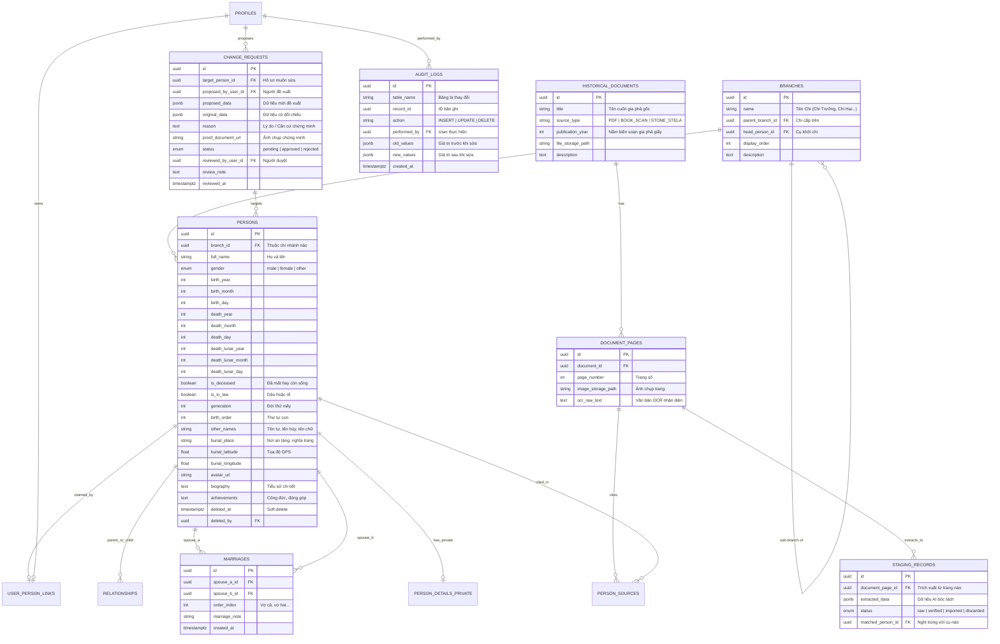

# 06. KIỂM TOÁN CƠ SỞ DỮ LIỆU VÀ TOÀN VẸN QUAN HỆ (DATABASE ARCHITECTURE AUDIT)

**Dự án:** Gia Phả OS (Gia Phả Họ Chu)  
**Hệ quản trị:** PostgreSQL 15+ trên nền tảng Supabase Cloud  
**Nguyên tắc cốt lõi:** KHÔNG TỰ Ý CHẠY MIGRATION THAY ĐỔI SCHEMA TRONG GIAI ĐOẠN AUDIT. Mọi đề xuất nâng cấp được thiết kế dưới dạng Schema Blueprint V2 an toàn, không phá hủy dữ liệu (Non-destructive).

---

## 1. ĐÁNH GIÁ 16 ĐIỂM THEN CHỐT THEO MASTER PROMPT

### 1.1. Cách lưu trữ Thành viên (Person Entity)
- **Thực tế mã nguồn (`docs/schema.sql` lines 71-108):**
  - Bảng chính `public.persons`: Lưu `id` (UUID), `full_name`, `gender` (enum: `male`, `female`, `other`), các trường ngày tháng riêng rẽ (`birth_year`, `birth_month`, `birth_day`, `death_year`, `death_month`, `death_day`, `death_lunar_year`, `death_lunar_month`, `death_lunar_day`), `is_deceased`, `is_in_law`, `birth_order`, `generation`, `other_names`, `avatar_url`, `note`, `burial_place`.
  - Bảng phụ `public.person_details_private`: Quan hệ 1-1 qua `person_id REFERENCES persons(id) ON DELETE CASCADE`, lưu `phone_number`, `occupation`, `current_residence`.
- **Đánh giá:**
  - *Ưu điểm:* Việc tách năm, tháng, ngày thành các cột số nguyên riêng biệt là quyết định kiến trúc rất chính xác cho gia phả Việt Nam, vì các cụ xưa nhiều người chỉ nhớ năm sinh hoặc chỉ nhớ ngày giỗ âm lịch mà không biết ngày tháng dương lịch.
  - *Hạn chế:* Thiếu trường xác định Chi nhánh (`branch_id`), thiếu liên kết tài khoản (`claimed_by_user_id`), thiếu phân loại quê quán gốc vs nơi ở hiện tại.

### 1.2. Quan hệ Cha Mẹ / Con Cái (Parent-Child Relationships)
- **Thực tế:** Bảng `public.relationships` với `type = 'biological_child'` hoặc `'adopted_child'`.
  - Quy ước: `person_a` là Cha hoặc Mẹ, `person_b` là Con.
- **Đánh giá:**
  - Linh hoạt, hỗ trợ cả con đẻ và con nuôi.
  - Hạn chế: Khi một người con có cả cha và mẹ trong hệ thống, hệ thống lưu thành **2 bản ghi riêng biệt** (`Cha -> Con` và `Mẹ -> Con`). Nếu cha có nhiều vợ, việc xác định chính xác người con là do bà vợ nào sinh ra phụ thuộc vào việc người tạo có nhớ gán đủ cả 2 quan hệ hay không.

### 1.3. Quan hệ Hôn Nhân (Marriage / Union)
- **Thực tế:** `relationships` với `type = 'marriage'`. Có ràng buộc `CHECK (person_a != person_b)` và `UNIQUE(person_a, person_b, type)`.
- **Đánh giá:**
  - Hỗ trợ tốt đa thê (một người nam có quan hệ marriage với nhiều người nữ) và đa phu.
  - Vấn đề: `UNIQUE(person_a, person_b, type)` không ngăn chặn việc tạo cặp đảo chiều (`person_b, person_a, 'marriage'`) ở tầng Database constraint, dù tầng ứng dụng (`utils/relationships/shared.ts`) có kiểm tra trước khi insert. Cần bổ sung Unique Index không phân biệt thứ tự: `UNIQUE LEAST(person_a, person_b), GREATEST(person_a, person_b)`.

### 1.4. Quan hệ Chi Nhánh (Lineage / Branch)
- **Thực tế:** **HOÀN TOÀN KHÔNG CÓ BẢNG CHI NHÁNH TRONG DATABASE.**
- **Đánh giá rủi ro:** Đây là lỗ hổng cấu trúc dữ liệu lớn nhất đối với một dòng họ lớn như họ Chu. Không thể lọc dữ liệu, không thể phân quyền quản lý theo chi, không thể thống kê nhân khẩu theo từng nhánh.

### 1.5. Cách xác định Đời thứ (Generation Indexing)
- **Thực tế:** Lưu tĩnh trong cột `generation INT` của bảng `persons`.
- **Cơ chế cập nhật:** Thông qua RPC `public.update_generations(updates jsonb)` (tại migration `20261026120000_add_update_generations.sql`) chạy cập nhật hàng loạt theo mảng JSON gửi từ client sau khi client tính toán BFS (`utils/lineageCompute.ts`).
- **Đánh giá:** Hiệu năng tốt cho tập dữ liệu vừa, nhưng việc phụ thuộc vào tính toán BFS phía client tiềm ẩn nguy cơ lệch đời nếu có nhiều người cùng chỉnh sửa đồng thời.

### 1.6. Khả năng có nhiều mối quan hệ với một người
- Bảng `relationships` cho phép một người xuất hiện ở nhiều bản ghi (vừa là con của cha mẹ, vừa là vợ/chồng của nhiều người, vừa là cha mẹ của nhiều con). Ràng buộc `no_self_relationship` ngăn chặn tự liên kết với chính mình.

### 1.7. Cơ chế Chống trùng lặp (Deduplication Mechanism)
- **Thực tế:** Quét ở tầng ứng dụng (`app/actions/duplicateScan.ts`) dựa trên tên chuẩn hóa + năm sinh hoặc tên + cùng cha/mẹ.
- **RPC Gộp người trùng:** `private.merge_persons(keep_id uuid, drop_id uuid)` (migration `20261027120000_add_merge_persons.sql`) được viết rất công phu: Chuyển toàn bộ quan hệ, gộp private details, gộp avatar và xóa người trùng trong một transaction duy nhất.

### 1.8. Ràng buộc Khóa ngoại (Foreign Key Constraints)
- Tất cả các bảng con (`relationships`, `person_details_private`, `gallery_item_persons`) đều có `ON DELETE CASCADE` trỏ tới `persons(id)`.
- Đảm bảo khi một thành viên bị xóa thì không để lại dữ liệu mồ côi (Orphaned records).

### 1.9. Ngăn chặn Quan hệ Vòng lặp Vô lý (Cycle Prevention)
- Tầng cơ sở dữ liệu hiện tại chưa có Recursive Constraint (vì PostgreSQL không hỗ trợ native cyclic check trên constraint đơn giản).
- Việc chống vòng lặp (ví dụ: con làm cha của ông nội) đang được kiểm tra ở tầng ứng dụng (`utils/relationshipValidation.ts`) và công cụ quét rà soát (`utils/dataChecks.ts`).

### 1.10. Xóa & Khôi phục Dữ liệu (Soft Delete vs Hard Delete)
- **Thực tế:** Hệ thống sử dụng **HARD DELETE** hoàn toàn (`DELETE FROM persons WHERE id = ...`).
- **Đánh giá rủi ro:** CỰC KỲ NGUY HIỂM đối với dữ liệu gia phả dòng họ. Một khi Editor bấm xóa nhầm một cụ tổ, cơ chế `ON DELETE CASCADE` có thể xóa sạch toàn bộ các mối quan hệ liên quan. Bắt buộc V2 phải chuyển sang cơ chế **Soft Delete** (`deleted_at TIMESTAMPTZ`, `deleted_by UUID`).

### 1.11. Lịch sử Thay đổi (Audit Trail)
- **Thực tế:** Chỉ có cột `updated_at`. **KHÔNG CÓ AUDIT LOG.**
- Không thể biết ai đã thay đổi ngày mất của một cụ, ai đã xóa mối quan hệ, ai đã sửa nơi an táng.

### 1.12. Truy vết Nguồn thông tin (Historical Provenance Tracking)
- **Thực tế:** Chưa có bảng lưu trữ nguồn tư liệu (sách gia phả giấy năm nào, văn bia nào, ai cung cấp). Mọi thông tin chỉ có trường `note` ghi chung.

### 1.13. Hiệu năng Truy vấn Dữ liệu Nhiều Thế Hệ
- **Thực tế:** Client fetch toàn bộ danh sách `persons` và `relationships` rồi tự dựng đồ thị bằng JavaScript trên trình duyệt.
- Với quy mô họ Chu hàng nghìn người, cần chuyển các truy vấn phả hệ sâu sang **PostgreSQL Recursive CTE** phía server để chỉ lấy đúng nhánh cần xem.

### 1.14. Indexing & Pagination
- Các bảng hiện có đầy đủ indexes: `idx_persons_full_name`, `idx_persons_generation`, `idx_relationships_person_a`, `idx_relationships_person_b`, `idx_relationships_type`.
- Đã hỗ trợ phân trang batched list tốt.

### 1.15. Quy tắc liên quan đến Người còn sống (Living Person Privacy)
- Đã có trường `is_deceased BOOLEAN`.
- Tuy nhiên RLS chỉ áp dụng bảo mật riêng cho bảng `person_details_private`, còn trên bảng `persons` thì họ tên, ngày sinh của người còn sống vẫn được trả về đầy đủ cho mọi tài khoản `member`.

### 1.16. Khả năng Nhập Dữ liệu Gia phả Giấy (Staging Area)
- **Thực tế:** Hoàn toàn chưa có cấu trúc bảng tạm (Staging schema) để lưu kết quả OCR trước khi kiểm chứng.

---

## 2. PHÂN ĐỊNH RÕ RÀNG CÁC THỰC THỂ (ENTITY SEPARATION)

Trong Gia Phả OS V2, bắt buộc phải phân tách rạch ròi giữa 8 thực thể:
1. **Person Entity (`persons`):** Con người lịch sử/thực tế trong gia phả (dù đã mất 500 năm hay mới sinh).
2. **User Account (`auth.users` & `profiles`):** Tài khoản đăng nhập hệ thống của con cháu hiện tại.
3. **User-Person Link (`user_person_links`):** Sự liên kết xác thực giữa tài khoản User và một Person cụ thể trên cây.
4. **Family Relationship (`relationships`):** Liên kết huyết thống phụ tử/mẫu tử giữa các Person.
5. **Marriage / Union (`marriages`):** Mối quan hệ hôn nhân giữa 2 Person, có thứ tự vợ/chồng.
6. **Branch (`branches`):** Chi phái, phân chi trong dòng họ Chu.
7. **Change Request (`change_requests`):** Đề xuất chỉnh sửa của thành viên chờ duyệt.
8. **Audit Log (`audit_logs`):** Vết thay đổi hệ thống bất biến (Append-only).

---

## 3. THIẾT KẾ MÔ HÌNH DỮ LIỆU MỤC TIÊU V2 (TARGET ERD BLUEPRINT)

