# 08. ĐỀ XUẤT ĐỊNH HƯỚNG SẢN PHẨM VÀ THIẾT KẾ GIA PHẢ OS V2 (TARGET PRODUCT & DESIGN PROPOSAL)

**Dự án:** Gia Phả OS V2 — Phiên bản chuyên dụng cho Đại Tộc Họ Chu  
**Tầm nhìn:** Nền tảng Gia phả số hiện đại, thiêng liêng, trường tồn cùng thời gian; kết nối hàng nghìn con cháu họ Chu khắp ba miền và trên toàn thế giới; bảo tồn chính xác tuyệt đối phả hệ dòng tộc qua các thế hệ.

---

## 1. TẦM NHÌN SẢN PHẨM V2 (PRODUCT VISION)

Gia Phả OS V2 không chỉ là một phần mềm vẽ cây gia phả đơn thuần, mà là **Không Gian Số Của Dòng Họ (Digital Ancestral Clan Space)**:
1. **Trực quan & Dễ dùng đa thế hệ:** Các cụ cao niên 70-80 tuổi có thể dễ dàng đọc chữ lớn, xem ngày giỗ, xem phả ký; thanh thiếu niên có thể tra cứu nhanh danh xưng, biết rõ cội nguồn và vị trí của mình trong dòng tộc.
2. **Quản trị phân cấp theo Chi phái (Decentralized Governance):** Trưởng các Chi phái chủ động cập nhật dữ liệu của chi mình mà không làm ảnh hưởng đến phả hệ chung của cả dòng họ.
3. **Số hóa có kiểm chứng (Verifiable Digitization):** Từng dòng thông tin trên cây gia phả số đều có thể dẫn nguồn đối chiếu về trang sách gia phả chữ Quốc ngữ gốc hoặc văn bia lịch sử.
4. **Cộng tác có kiểm soát (Human-in-the-loop Collaboration):** Mọi thành viên đều có thể gửi đề xuất bổ sung thông tin (sinh con, kết hôn, nơi an táng), nhưng chỉ được ghi nhận chính thức sau khi được Ban trị sự phê duyệt.

---

## 2. KIẾN TRÚC THÔNG TIN VÀ SITEMAP MỤC TIÊU V2 (TARGET IA & SITEMAP)

Hệ thống V2 được tổ chức thành 4 phân vùng rõ ràng theo vai trò người dùng:

```mermaid
flowchart TD
    ROOT[Gia Phả Họ Chu - Cổng Thông Tin Số]
    
    ROOT --> PUBLIC[1. Phân vùng Công Khai]
    PUBLIC --> PUB_HOME[Trang chủ & Lời tựa dòng họ Chu]
    PUBLIC --> PUB_HISTORY[Lịch sử dòng họ & Thủy tổ]
    PUBLIC --> PUB_TEMPLE[Nhà thờ tổ & Địa chỉ Từ đường]
    PUBLIC --> PUB_LOGIN[Cổng đăng nhập con cháu]

    ROOT --> MEMBER_PORTAL[2. Không Gian Thành Viên Con Cháu]
    MEMBER_PORTAL --> TREE_VIEW[Cây Gia Phả Đa Chế Độ]
    TREE_VIEW --> VIEW_TREE[Cây truyền thống]
    TREE_VIEW --> VIEW_MINDMAP[Sơ đồ tư duy]
    TREE_VIEW --> VIEW_LIST[Danh sách thành viên]
    
    MEMBER_PORTAL --> BRANCHES[Chi Phái Dòng Họ]
    BRANCHES --> BRANCH_DETAIL[Xem riêng từng Chi: Trưởng, Hai, Ba...]
    
    MEMBER_PORTAL --> KINSHIP[Tra Cứu Danh Xưng & Quan Hệ]
    MEMBER_PORTAL --> EVENTS[Lịch Giỗ Tết & Lễ Hội Dòng Tộc]
    MEMBER_PORTAL --> GALLERY[Nhà Truyền Thống & Tư Liệu Ảnh]
    MEMBER_PORTAL --> BOOK[Phả Ký In Thành Sách]
    MEMBER_PORTAL --> MY_PROFILE[Hồ Sơ Của Tôi & Gia Đình Nhỏ]
    MY_PROFILE --> PROPOSE_EDIT[Đề xuất bổ sung thông tin]

    ROOT --> BRANCH_ADMIN[3. Cổng Quản Trị Chi Phái]
    BRANCH_ADMIN --> MANAGE_BRANCH_MEMBERS[Biên tập thành viên trong Chi]
    BRANCH_ADMIN --> REVIEW_PROPOSALS[Phê duyệt đề xuất của con cháu trong Chi]
    BRANCH_ADMIN --> INVITE_MEMBER[Tạo mã mời con cháu tham gia]

    ROOT --> MASTER_ADMIN[4. Cổng Hội Đồng Dòng Họ Chu]
    MASTER_ADMIN --> DIGITIZE[Số hóa gia phả giấy & OCR/AI Staging]
    MASTER_ADMIN --> CLAN_AUDIT[Nhật ký kiểm toán & Lịch sử thay đổi]
    MASTER_ADMIN --> DATA_INTEGRITY[Kiểm tra xung đột & Gộp trùng toàn họ]
    MASTER_ADMIN --> BACKUP_RESTORE[Sao lưu định kỳ & Phục hồi]
    MASTER_ADMIN --> USER_ROLES[Phân quyền Trưởng chi & Quản trị viên]
```

---

## 3. THIẾT KẾ LẠI CÁC TRẢI NGHIỆM VÀ LUỒNG TƯƠNG TÁC CHÍNH

### 3.1. Trải nghiệm Cây gia phả (Tree Navigation Redesign)
- **Thanh công cụ nổi (Floating Island Toolbar):** Chuyển toolbar từ dạng thanh ngang cố định sang thanh công cụ bo tròn nổi ở góc dưới màn hình, giúp mở rộng tối đa không gian hiển thị cây.
- **Bộ lọc Chi phái nhanh:** Trên thanh công cụ có nút bấm chọn Chi (ví dụ: `[Toàn Họ] | [Chi Trưởng] | [Chi Hai] | [Chi Ba]`). Khi chọn một chi, hệ thống tự động ẩn các chi khác, giúp người dùng tập trung xem nhánh của mình.
- **Nút "Tìm vị trí của tôi" (Locate Me):** Một nút bấm đưa góc nhìn thẳng về vị trí của tài khoản đang đăng nhập trên cây.
- **Chế độ xem Cây dọc cho Mobile (Vertical Clan Flow):** Cho phép người dùng điện thoại chuyển từ sơ đồ cây ngang sang dạng cây thẻ dọc xếp theo từng đời, vuốt dọc tự nhiên như một danh sách tin tức.

### 3.2. Form Nhập liệu phân bước (Multi-step Wizard)
Thay thế form dài hiện tại bằng Wizard 3 bước rõ ràng:
- **Bước 1 — Quan hệ & Thế hệ:** Chọn người thân trên cây (Con của ai, Vợ của ai), chọn Chi nhánh.
- **Bước 2 — Nhân thân:** Họ tên, Tên chữ/tên húy, Giới tính, Ngày sinh.
- **Bước 3 — Hậu sự (nếu đã mất):** Ngày mất (Dương & Âm lịch), Nơi an táng, Ảnh bia mộ/chân dung.

---

## 4. QUY CHUẨN THIẾT KẾ MỤC TIÊU V2 (TARGET DESIGN SYSTEM)

### 4.1. Phong cách Thẩm mỹ: "Trang Trọng — Ấm Áp — Thuần Việt"
- **Triết lý:** Loại bỏ hoàn toàn sự khô cứng của phần mềm công nghệ thông thường. Gia Phả OS V2 phải toát lên tinh thần "Uống nước nhớ nguồn", tựa như một cuốn Tộc phả cổ kính được đặt trang trọng trong Từ đường nhưng xem được trên màn hình điện thoại thông minh.
- **Màu sắc chủ đạo:**
  - *Màu Gỗ Mộc Trầm (`#1c1917` / `#292524`):* Màu xà gồ gỗ lim nhà thờ tổ, dùng cho văn bản và tiêu đề chính.
  - *Màu Giấy Dó Cổ (`#fafaf9` / `#f5f5f4`):* Nền trang dịu mắt, không gây chói lóa khi các cụ đọc lâu.
  - *Màu Vàng Hoàng Thổ / Hổ Phách (`#d97706` / `#b45309`):* Điểm nhấn trang trọng cho các thế hệ cụ tổ, nút thao tác chính và các ngày lễ giỗ.
  - *Màu Đỏ Son Truyền Thống (`#991b1b`):* Điểm xuyết cho các ngày giỗ trọng thể và con dấu dòng họ.
- **Kiểu chữ (Typography):**
  - Tiêu đề & Bìa sách: *Playfair Display* hoặc *Merriweather* (Serif).
  - Nội dung & Bảng dữ liệu: *Inter* hoặc *Be Vietnam Pro* (Sans-serif tối ưu dấu thanh tiếng Việt).
  - Tích hợp nút phóng to cỡ chữ nhanh: Tiêu chuẩn (16px) / Chữ lớn cho người cao tuổi (20px).

---

## 5. ĐÁNH GIÁ VÀ LỰA CHỌN PHƯƠNG ÁN NÂNG CẤP KIẾN TRÚC

| Tiêu chí so sánh | Phương án A: Giữ nguyên, vá lỗi nhỏ | Phương án B: Tái cấu trúc trọng yếu & Mở rộng module (KHUYẾN NGHỊ) | Phương án C: Đập đi xây lại toàn bộ (Rewrite) |
|---|---|---|---|
| **Mô tả** | Giữ nguyên schema, chỉ fix bug UI và thêm nút. | Kế thừa nền tảng Next.js 16/React 19 xuất sắc hiện có; mở rộng schema DB (thêm `branches`, `change_requests`, `audit_logs`, `staging`); tái cấu trúc Navigation và Form. | Vứt bỏ toàn bộ codebase hiện tại, chọn framework khác hoặc viết lại từ con số 0. |
| **Công sức (Effort)** | Thấp (1-2 tuần). | Vừa phải (4-6 tuần). | Cực kỳ lớn (3-6 tháng). |
| **Rủi ro hồi quy (Regression Risk)** | Thấp. | Thấp đến trung bình (Do schema mở rộng không phá hủy dữ liệu cũ). | Cực kỳ cao (Mất hết các tiện ích đã kiểm thử kỹ lưỡng như Kinship, Lunar, PDF export). |
| **Giải quyết bài toán họ Chu** | **KHÔNG ĐẠT.** Vẫn không có Chi nhánh, không có duyệt đề xuất, không có số hóa gia phả giấy. | **HOÀN TOÀN ĐẠT.** Giải quyết trọn vẹn 100% mục tiêu của Master Prompt. | Đạt nhưng lãng phí nguồn lực và thời gian. |
| **Chi phí & Bảo trì** | Thấp nhưng tích tụ nợ kỹ thuật. | Tối ưu nhất về ROI (Giá trị / Chi phí). | Rất tốn kém. |

### KẾT LUẬN & KHUYẾN NGHỊ: CHỌN PHƯƠNG ÁN B
- Codebase hiện tại của `giapha-os` (v2.5.1) có chất lượng kỹ thuật rất tốt: TypeScript nghiêm ngặt, linter sạch, thuật toán danh xưng và âm lịch cực kỳ chuẩn xác, bộ kiểm thử phong phú.
- Do đó, **Phương án B (Refactor & Module Extension)** là lựa chọn thông minh nhất: Bảo toàn toàn bộ thế mạnh hiện có, đồng thời cấy thêm các module then chốt (Chi nhánh, Đề xuất chỉnh sửa, Lịch sử kiểm toán, Số hóa gia phả giấy Staging) mà không làm gián đoạn hệ thống.
