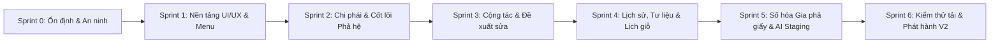

# 09. KẾ HOẠCH TRIỂN KHAI VÀ ROADMAP CHI TIẾT (IMPLEMENTATION ROADMAP V2)

**Dự án:** Gia Phả OS V2 (Gia Phả Họ Chu)  
**Chiến lược:** Triển khai theo từng Sprint tuần tự, kiểm soát chặt chẽ Quality Gate, không phá vỡ dữ liệu sẵn có, đảm bảo kiểm thử và rollback an toàn.

---

## 1. TỔNG QUAN LỘ TRÌNH 7 SPRINTS

---

## 2. CHI TIẾT TỪNG SPRINT VÀ CÁC ĐẦU VIỆC (TASK BREAKDOWN)

---

### SPRINT 0: ỔN ĐỊNH HỆ THỐNG & TĂNG CƯỜNG BẢO VỆ DỮ LIỆU (STABILIZATION & DATA SAFETY)
*Mục tiêu:* Khắc phục các rủi ro bảo mật tức thì, bảo vệ dữ liệu khỏi nguy cơ xóa nhầm (Hard Delete), chuẩn hóa môi trường kiểm thử.

#### TASK S0-01: Chuyển đổi Cơ chế Xóa sang Soft Delete (Bảo vệ dữ liệu phả hệ)
- **Vấn đề:** Hiện tại khi xóa thành viên, DB thực hiện Hard Delete và CASCADE xóa toàn bộ quan hệ liên quan, không thể khôi phục.
- **Mục tiêu:** Thêm cột `deleted_at TIMESTAMPTZ` và `deleted_by UUID` vào bảng `persons`, cập nhật các RLS policies để tự động ẩn các bản ghi đã xóa thay vì xóa vĩnh viễn.
- **Phạm vi:** `docs/migrations/`, `utils/supabase/queries.ts`, `app/actions/member.ts`.
- **Dependency:** Không.
- **Mức độ ưu tiên:** **P0**.
- **Độ khó tương đối:** Trung bình (3/5).
- **Rủi ro:** Một số câu query cũ có thể hiển thị cả bản ghi đã xóa nếu chưa thêm điều kiện `deleted_at IS NULL`.
- **Acceptance Criteria:**
  - Thành viên bị xóa biến mất khỏi Cây và Danh sách trên giao diện.
  - Bản ghi trong bảng `persons` vẫn còn trong DB với timestamp `deleted_at`.
  - Admin có nút "Thùng rác phả hệ" để khôi phục khi cần.
- **Test Plan:** Thử tạo 1 người mẫu, gắn quan hệ, bấm xóa, kiểm tra DB xem dữ liệu còn không, bấm khôi phục xem quan hệ có phục hồi không.
- **Rollback Plan:** Xóa migration nếu phát sinh lỗi; schema cũ vẫn nguyên vẹn.

#### TASK S0-02: Chuẩn hóa Test Runner độc lập với Bun
- **Vấn đề:** 58 file test hiện tại chỉ chạy được với runtime Bun, gây lỗi trên CI/CD tiêu chuẩn và máy Windows chạy Node.js.
- **Mục tiêu:** Cấu hình Vitest làm test runner dự phòng hoặc chuẩn hóa runner cho Node.js.
- **Phạm vi:** `package.json`, cấu hình test runner.
- **Mức độ ưu tiên:** **P1**.
- **Độ khó:** Dễ (2/5).
- **Rủi ro:** Không.
- **Acceptance Criteria:** Chạy `npm test` thành công trên cả môi trường Node.js mà không cần cài Bun.

---

### SPRINT 1: NỀN TẢNG GIAO DIỆN & TÁI CẤU TRÚC ĐIỀU HƯỚNG (UI/UX & NAVIGATION FOUNDATION)
*Mục tiêu:* Đưa toàn bộ tính năng bị ẩn ra thanh Menu chính, tối ưu hóa giao diện cho người cao tuổi và màn hình điện thoại.

#### TASK S1-01: Tái cấu trúc Thanh Điều Hướng (Top Navigation & Mobile Bottom Bar)
- **Vấn đề:** Mọi menu chính bị giấu trong Pop-up Avatar; trang Sự kiện và Thư viện ảnh bị mất liên kết trên header.
- **Mục tiêu:** Xây dựng Top Navigation Bar trang trọng hiển thị các phân khu: Trang chủ, Cây gia phả, Chi phái, Lịch giỗ, Nhà truyền thống, Xưng hô, Phả ký. Bổ sung Mobile Bottom Bar 5 tab.
- **Phạm vi:** `components/DashboardHeader.tsx`, `components/HeaderMenu.tsx`, tạo `components/navigation/BottomBar.tsx`.
- **Dependency:** S0.
- **Mức độ ưu tiên:** **P0**.
- **Độ khó:** Trung bình (3/5).
- **Rủi ro:** Xung đột bố cục (layout shift) trên các màn hình tablet cỡ lỡ dở (768px - 1024px).
- **Acceptance Criteria:**
  - Desktop: Menu hiển thị đầy đủ, có trạng thái Active rõ ràng cho từng trang.
  - Mobile: Thanh tab bar cố định ở đáy màn hình, dễ bấm bằng 1 tay.
  - Người cao tuổi bấm là chuyển trang ngay, không phải mở dropdown menu.

#### TASK S1-02: Tối ưu Điểm chạm & Chế độ Chữ Lớn cho Người Cao Tuổi
- **Vấn đề:** Nút toggle thu gọn cành cây quá nhỏ (24px), font chữ 12-14px khó đọc.
- **Mục tiêu:** Tăng touch target nút bấm cây lên 44px; thêm bộ chọn cỡ chữ A- / A+ trên thanh công cụ.
- **Phạm vi:** `components/FamilyTreeNodeRenderer.tsx`, `DESIGN.md`, `app/globals.css`.
- **Mức độ ưu tiên:** **P1**.
- **Độ khó:** Dễ (2/5).

---

### SPRINT 2: MÔ HÌNH CHI PHÁI & CỐT LÕI PHẢ HỆ (CORE GENEALOGY & BRANCH HIERARCHY)
*Mục tiêu:* Bổ sung thực thể Chi phái vào cơ sở dữ liệu và cho phép lọc cây theo từng Chi của họ Chu.

#### TASK S2-01: Mở rộng Schema Cơ Sở Dữ Liệu: Bảng `branches`
- **Vấn đề:** Hệ thống hoàn toàn không có khái niệm Chi/Nhánh trong database.
- **Mục tiêu:** Tạo bảng `public.branches` (`id`, `name`, `parent_branch_id`, `head_person_id`, `description`, `order_index`), thêm cột `branch_id REFERENCES branches(id)` vào bảng `persons`.
- **Phạm vi:** Migration SQL mới, `types/index.ts`.
- **Dependency:** S0-01.
- **Mức độ ưu tiên:** **P0**.
- **Độ khó:** Trung bình (3/5).
- **Rủi ro:** Cần gán giá trị mặc định (Default Branch: "Toàn Họ") cho các thành viên hiện tại để không vi phạm khóa ngoại.
- **Acceptance Criteria:** Bảng `branches` được tạo thành công; các thành viên cũ được gán vào Chi mặc định mà không mất dữ liệu.

#### TASK S2-02: Bộ Lọc Chi Phái & Quản lý Chi trên Giao Diện Cây
- **Vấn đề:** Cây gia phả vẽ toàn bộ dòng họ, không xem riêng được từng Chi.
- **Mục tiêu:** Thêm dropdown chọn Chi trên `TreeToolbar.tsx`. Khi chọn Chi Hai, cây chỉ hiển thị cụ khởi Chi Hai và con cháu của cụ.
- **Phạm vi:** `components/TreeToolbar.tsx`, `components/FamilyTree.tsx`, `utils/treeHelpers.ts`.
- **Mức độ ưu tiên:** **P0**.
- **Độ khó:** Cao (4/5).
- **Acceptance Criteria:** Chọn chi nào thì cây chuyển mượt mà về chi đó; URL cập nhật param `?branchId=...` để có thể gửi link cho con cháu trong chi.

---

### SPRINT 3: CỘNG TÁC, ĐỀ XUẤT CHỈNH SỬA & NHẬT KÝ KIỂM TOÁN (COLLABORATION & GOVERNANCE)
*Mục tiêu:* Cho phép con cháu gửi đề xuất sửa thông tin; Trưởng chi duyệt đề xuất; ghi nhận lịch sử thay đổi.

#### TASK S3-01: Hệ thống Đề Xuất & Phê Duyệt (Change Request System)
- **Vấn đề:** Thành viên thường không có quyền sửa; nếu cấp quyền Editor thì họ có thể sửa/xóa bất kỳ ai.
- **Mục tiêu:**
  - Tạo bảng `change_requests`.
  - Trên hồ sơ cá nhân của thành viên, thêm nút "Đề xuất cập nhật".
  - Xây dựng màn hình "Phê duyệt đề xuất" dành cho Trưởng chi và Admin, hiển thị so sánh Diff Cũ vs Mới trước khi bấm Duyệt.
- **Phạm vi:** Migration SQL, Server Actions mới `app/actions/proposals.ts`, màn hình `/dashboard/proposals`.
- **Mức độ ưu tiên:** **P0**.
- **Độ khó:** Cao (4/5).
- **Acceptance Criteria:** Khi thành viên gửi đề xuất, Admin nhận thông báo; khi Admin duyệt, dữ liệu cập nhật vào `persons` trong 1 transaction an toàn.

#### TASK S3-02: Nhật Ký Kiểm Toán (Audit Trail / Change Log)
- **Vấn đề:** Không lưu lịch sử ai sửa ai xóa.
- **Mục tiêu:** Tạo bảng `audit_logs` và Database Trigger tự động ghi lại vết mỗi khi có thao tác INSERT, UPDATE, DELETE trên bảng `persons` và `relationships`.
- **Mức độ ưu tiên:** **P0**.
- **Độ khó:** Trung bình (3/5).

---

### SPRINT 4: LỊCH SỬ DÒNG HỌ, TƯ LIỆU & LỊCH GIỖ (HISTORICAL & CLAN CULTURE)
*Mục tiêu:* Tôn vinh cội nguồn họ Chu, kết nối lịch sử và nhắc nhở ngày giỗ tổ tiên.

#### TASK S4-01: Xây dựng Cổng Thông Tin Dòng Họ Chu & Lịch Sử Nhà Thờ Tổ
- **Mục tiêu:** Nâng cấp trang chủ và trang `/about` thành trang truyền thống họ Chu: Lời tựa tộc phả, lịch sử Thủy Tổ, hình ảnh Nhà thờ họ và các địa điểm Từ đường.
- **Mức độ ưu tiên:** **P1**.
- **Độ khó:** Dễ (2/5).

#### TASK S4-02: Bản đồ Mộ phần & Chỉ dẫn An táng Gia tộc
- **Mục tiêu:** Bổ sung tọa độ GPS vào nơi an táng; hiển thị bản đồ định vị trên hồ sơ người đã mất.
- **Mức độ ưu tiên:** **P2**.
- **Độ khó:** Trung bình (3/5).

---

### SPRINT 5: SỐ HÓA GIA PHẢ GIẤY & AI STAGING (CONTROLLED DIGITIZATION)
*Mục tiêu:* Hỗ trợ tải lên ảnh scan/PDF gia phả chữ Quốc ngữ, OCR bóc tách thực thể và đưa vào khu vực đối chiếu cách ly trước khi nhập.

#### TASK S5-01: Quản lý Tài liệu Gia phả gốc (Historical Document Storage)
- **Mục tiêu:** Tạo bucket `historical_documents` và bảng `historical_documents`, `document_pages` để lưu file PDF/ảnh scan gia phả giấy gốc.
- **Mức độ ưu tiên:** **P1**.
- **Độ khó:** Trung bình (3/5).

#### TASK S5-02: Khu vực Kiểm Soát Đối Chiếu Cách Ly (Staging Area & Human-in-the-loop Review)
- **Mục tiêu:**
  - Tạo bảng `staging_persons` và `staging_relationships`.
  - Màn hình đối chiếu song song: Bên trái ảnh trang sách gia phả gốc, bên phải bảng danh sách thành viên AI trích xuất.
  - Ban biên tập kiểm tra, chỉnh sửa và bấm "Duyệt nhập vào gia phả chính".
  - **NGUYÊN TẮC:** Tuyệt đối không cho AI ghi đè trực tiếp vào bảng `persons`.
- **Mức độ ưu tiên:** **P0** (cho module số hóa).
- **Độ khó:** Rất cao (5/5).
- **Acceptance Criteria:** Dữ liệu chỉ vào gia phả chính khi có người thật kiểm tra và bấm xác nhận; lưu kèm liên kết trỏ về trang tài liệu gốc.

---

### SPRINT 6: TỐI ƯU HIỆU NĂNG, KIỂM THỬ TẢI & PHÁT HÀNH CHÍNH THỨC (QA & V2 RELEASE)
*Mục tiêu:* Kiểm tra khả năng chịu tải với 5.000 thành viên, bảo mật toàn diện và sẵn sàng bàn giao cho Ban trị sự dòng họ Chu.

#### TASK S6-01: Kiểm thử Tải & Tối ưu Virtualization cho Cây lớn
- **Mục tiêu:** Tạo seed dữ liệu mẫu 5.000 người họ Chu qua 12 đời; tối ưu thuật toán vẽ cây không bị nghẽn DOM; đo đạc tốc độ tải dưới 2 giây.
- **Mức độ ưu tiên:** **P0**.
- **Độ khó:** Cao (4/5).

#### TASK S6-02: Kiểm toán An ninh Toàn diện & Sao lưu Dự phòng
- **Mục tiêu:** Rà soát lại toàn bộ RLS policies, phân quyền Trưởng chi, thiết lập lịch sao lưu cơ sở dữ liệu tự động hàng tuần lên cloud storage độc lập.
- **Mức độ ưu tiên:** **P0**.
- **Độ khó:** Trung bình (3/5).
