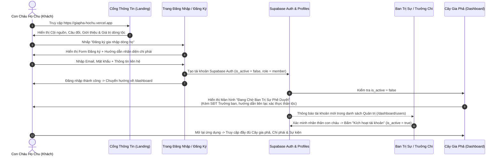

# AUDIT & ĐẶC TẢ THIẾT KẾ: LANDING PAGE & AUTHENTICATION (GIA PHẢ HỌ CHU)

> **Tài liệu bàn giao giai đoạn Audit mở rộng:** Bổ sung phạm vi Trang chủ công khai (Landing Page), Xác thực (Authentication) và Phân quyền tiếp cận (Access Gating).  
> **Nguyên tắc tuân thủ:** Chỉ audit và lập đặc tả thiết kế, **chưa sửa code production**, giữ nguyên phân quyền và database.

---

## 1. AUDIT HIỆN TRẠNG (CURRENT STATE AUDIT)

### 1.1. Trang chủ công khai (`app/page.tsx` & `components/LandingHero.tsx`)

#### Điểm còn tồn tại & Hạn chế:
1. **Phong cách giao diện mang hơi hướng "SaaS / Tech Startup" thay vì "Cổng Văn Hóa Dòng Tộc":**
   - Huy hiệu `Sparkles` với text dạng tiếp thị sản phẩm phần mềm.
   - 3 Card tính năng kỹ thuật ở chân trang: *"Thành viên"* (lưu trữ hồ sơ), *"Cây gia phả"* (trực quan hóa), *"Bảo mật"* (phân quyền dữ liệu). Cách tiếp cận này hướng về tính năng phần mềm thay vì giá trị tinh thần thiêng liêng của một dòng tộc (Cội nguồn, Kết nối con cháu, Di sản lưu truyền).
2. **Khoảng trắng và bố cục chưa tối ưu thị giác:**
   - Khoảng cách padding quá lớn (`py-20 md:py-32`) tạo cảm giác trống trải trên màn hình desktop độ phân giải cao.
   - Chưa có điểm nhấn thị giác trung tâm (biểu tượng Cây đại thụ gia tộc, họa tiết hoa văn truyền thống, hay hình ảnh Từ Đường họ Chu).
3. **Chưa xử lý trạng thái Auth nhạy bén (Contextual CTA):**
   - Hiện tại, dù người dùng đã đăng nhập hay chưa đăng nhập, nút bấm chính vẫn luôn hiển thị *"Bắt đầu khám phá"* trỏ về `/login`.
   - Đối với thành viên dòng họ đã đăng nhập từ trước, nút CTA cần tự động chuyển thành **"Vào Cây Phả Hệ"** hoặc **"Trang Quản Trị Dòng Họ"** trỏ trực tiếp vào `/dashboard` hoặc `/tree`.
4. **Bảo mật & Tính riêng tư (Privacy Guard):**
   - Trang chủ hiện tại hoàn toàn sạch, không rò rỉ dữ liệu thành viên hay sơ đồ gia phả riêng tư ra bên ngoài (đạt yêu cầu bảo mật).

---

### 1.2. Hệ thống Xác thực (`app/login/page.tsx`, `components/auth/*`, `utils/supabase/*`)

#### Điểm còn tồn tại & Hạn chế:
1. **Thiếu hoàn toàn chức năng "Quên mật khẩu" (Forgot Password Flow):**
   - Khảo sát mã nguồn xác nhận: Không có route hoặc form nào gọi `supabase.auth.resetPasswordForEmail()`.
   - Nếu con cháu họ Chu quên mật khẩu, họ không thể tự lấy lại mà buộc phải liên hệ thủ công với Admin để nhờ đặt lại mật khẩu trong `/dashboard/users`. Đây là rào cản trải nghiệm lớn cho người cao tuổi hoặc người ít rành công nghệ.
2. **Thiếu thông tin hướng dẫn con cháu đăng ký gia nhập:**
   - Form Đăng ký hiện tại chỉ có 2 ô: `Email` và `Mật khẩu`, kèm dòng mô tả ngắn.
   - Con cháu vào đăng ký không biết sau khi tạo tài khoản thì cần làm gì, bao lâu được duyệt, hoặc ai là người duyệt tài khoản để được xem gia phả.
3. **Cấu hình SSO (Google / Facebook):**
   - Mặc định `NEXT_PUBLIC_DISABLE_SSO=true`, SSO bị ẩn hợp lệ để fail-closed.
   - Khi bật SSO, nếu nhà cung cấp chưa cấu hình Client ID / Secret trên Supabase, hệ thống hiển thị thông báo lỗi thân thiện.
4. **Trạng thái tài khoản chờ duyệt (`is_active = false`):**
   - Luồng hiện tại: Khi đăng ký mới thành công, tài khoản ở trạng thái `is_active: false`.
   - Người dùng đăng nhập sẽ bị chặn tại `app/dashboard/layout.tsx` và hiển thị màn hình chờ duyệt (`pendingTitle`: "Tài khoản đang chờ phê duyệt").
   - Tuy nhiên, giao diện này còn đơn điệu, thiếu thông tin liên hệ trực tiếp của Ban Trị Sự / Trưởng Chi để con cháu có thể chủ động báo duyệt nhanh.
5. **Đồng bộ Design System:**
   - Trang login sử dụng một số mã màu cứng (`bg-[#fafaf9]`, icon `Shield text-amber-600`) chưa hoàn toàn đồng nhất với các tokens chuẩn trong `DESIGN.md` (màu gỗ gụ `#4A2818`, vải lanh `#FAF7F2`, hổ phách `#C2671A`).

---

## 2. USER FLOW: TỪ KHÁCH TRUY CẬP ĐẾN THÀNH VIÊN ĐƯỢC PHÊ DUYỆT



---

## 3. SITEMAP & KIẾN TRÚC ĐIỀU HƯỚNG MỚI (V2 NAVIGATION ARCHITECTURE)

```
CỔNG GIA PHẢ HỌ CHU
│
├── 1. VÙNG CÔNG KHAI (PUBLIC ZONE - Không yêu cầu đăng nhập)
│   ├── Trang chủ (Cổng cội nguồn, Giá trị dòng tộc, Lời tựa, Dẫn nhập) [/]
│   ├── Giới thiệu & Lịch sử dòng họ Chu (Thủy tổ, Các chi phái, Quy chế) [/about]
│   ├── Đăng nhập & Đăng ký thành viên [/login]
│   └── Quên / Đặt lại mật khẩu [/forgot-password]
│
├── 2. VÙNG CHỜ PHÊ DUYỆT (PENDING GATEWAY - Đã login nhưng is_active = false)
│   └── Màn hình chờ duyệt danh tính thân tộc (Thông tin liên hệ Ban Trị Sự)
│
└── 3. VÙNG THÀNH VIÊN CHÍNH THỨC (PROTECTED MEMBER ZONE - is_active = true)
    ├── Tổng quan dòng họ (Dashboard & Thống kê thế hệ) [/dashboard]
    ├── Cây gia phả tương tác đa thế hệ [/tree hoặc /dashboard/members]
    ├── Quản lý & Lọc theo Chi phái [/dashboard/branches]
    ├── Sổ phả ký dòng họ (Lineage Book) [/dashboard/lineage/book]
    ├── Sự kiện giỗ chạp & Lễ hội gia tộc [/dashboard/events]
    ├── Thư viện ảnh & Tư liệu cổ [/dashboard/gallery]
    ├── Đề xuất chỉnh sửa phả hệ (Con cháu gửi đóng góp) [Modal / Propose]
    │
    └── 4. VÙNG QUẢN TRỊ VIÊN & TRƯỞNG CHI (ADMIN & EDITOR ZONE)
        ├── Duyệt đề xuất chỉnh sửa phả hệ [/dashboard/proposals]
        ├── Bàn thẩm định số hóa gia phả giấy chữ Quốc ngữ [/dashboard/digitization]
        ├── Quản lý tài khoản & Duyệt thành viên mới [/dashboard/users]
        └── Sao lưu & Phục hồi dữ liệu [/dashboard/data]
```

---

## 4. WIREFRAME CHI TIẾT (DESKTOP & MOBILE)

### 4.1. Wireframe: Trang Chủ Công Khai (Landing Page)

#### Bố cục Desktop:
```
+-----------------------------------------------------------------------------------+
|  [Logo Cụ Chu] GIA PHẢ HỌ CHU               [Lịch sử dòng họ] [Ngôn ngữ] [ĐĂNG NHẬP] |
+-----------------------------------------------------------------------------------+
|                                                                                   |
|                      ✦ NƠI NGUỒN CỘI LƯU TRUYỀN MUÔN ĐỜI ✦                        |
|                                                                                   |
|                               GIA PHẢ HỌ CHU                                      |
|                                                                                   |
|           "Mộc xuất thiên chi do hữu bản — Thủy lưu vạn phái tổng đồng nguyên"    |
|            (Cây sinh ngàn nhánh do từ gốc — Nước chảy vạn dòng bởi một nguồn)      |
|                                                                                   |
|        [Biểu tượng Cây Đại Thụ Phả Hệ trang nghiêm mạ viền vàng đồng / gỗ gụ]       |
|                                                                                   |
|             [ Nút chính: VÀO CÂY GIA PHẢ ]     [ Nút phụ: TÌM HIỂU CỘI NGUỒN ]    |
|               (Tự đổi theo trạng thái Đăng nhập / Khách vãng lai)                 |
|                                                                                   |
+-----------------------------------------------------------------------------------+
|                              BA GIÁ TRỊ CỐT LÕI GIA TỘC                           |
|                                                                                   |
|  +------------------------+  +------------------------+  +---------------------+  |
|  |   [Icon Cây Phả Hệ]    |  |  [Icon Kết Nối Thân Tộc|  |   [Icon Di Sản Cổ]  |  |
|  |     CÂY GIA PHẢ        |  |   KẾT NỐI CON CHÁU     |  |   DI SẢN DÒNG HỌ    |  |
|  | Lưu truyền 7 thế hệ,   |  | Kết nối con cháu toàn  |  | Bảo tồn văn tự phả  |  |
|  | phân định rõ ràng các  |  | quốc & kiều bào, ghi   |  | ký, sắc phong cổ và |  |
|  | Chi Trưởng, Chi Hai,   |  | nhận ngày giỗ chạp và  |  | chỉ dẫn mộ phần tổ  |  |
|  | Chi Ba, Chi Phương Nam |  | khuyến học khuyến tài. |  | tiên cho muôn đời.  |  |
|  +------------------------+  +------------------------+  +---------------------+  |
|                                                                                   |
+-----------------------------------------------------------------------------------+
|  LỜI TỰA TỘC PHẢ: Trích văn bia Từ Đường Họ Chu về đạo lý "Uống nước nhớ nguồn"   |
+-----------------------------------------------------------------------------------+
|  FOOTER: Bản quyền Dòng Họ Chu Việt Nam • Thiết kế trang nghiêm, thuần khiết      |
+-----------------------------------------------------------------------------------+
```

#### Bố cục Mobile (Màn hình dọc):
```
+-----------------------------------+
| [Logo] GIA PHẢ HỌ CHU       [Menu]|
+-----------------------------------+
|                                   |
|   ✦ NƠI CỘI NGUỒN LƯU TRUYỀN ✦    |
|                                   |
|          GIA PHẢ HỌ CHU           |
|                                   |
|   "Mộc xuất thiên chi do hữu bản  |
|   Thủy lưu vạn phái đồng nguyên"  |
|                                   |
|     [Biểu tượng Cây Đại Thụ]      |
|                                   |
|   [  VÀO XEM CÂY PHẢ HỆ (CTA)  ]  |
|   [ Lịch Sử & Cội Nguồn Dòng Họ ] |
|                                   |
+-----------------------------------+
|   BA GIÁ TRỊ GIA TỘC (Card xếp)   |
|                                   |
| [1] CÂY GIA PHẢ ĐA CHI NHÁNH      |
|     Minh bạch 7 thế hệ dòng tộc   |
|                                   |
| [2] KẾT NỐI ĐỒNG TỘC MUÔN PHƯƠNG  |
|     Tri ân tiên tổ, ngày giỗ chạp |
|                                   |
| [3] DI SẢN & MỘ PHẦN TÂM LINH     |
|     Chỉ dẫn viếng mộ trên Maps    |
|                                   |
+-----------------------------------+
| [Footer Dòng Họ Chu • Bản sắc Việt|
+-----------------------------------+
```

---

### 4.2. Wireframe: Trang Đăng Nhập, Đăng Ký & Quên Mật Khẩu (`/login`)

```
+-----------------------------------------------------------------------------------+
| [< Về trang chủ]                                            [Ngôn ngữ] [Giới thiệu|
+-----------------------------------------------------------------------------------+
|                                                                                   |
|                         +-------------------------------+                         |
|                         |       [Huy hiệu Gia Tộc]      |                         |
|                         |         GIA PHẢ HỌ CHU        |                         |
|                         |    Đăng nhập cổng phả hệ      |                         |
|                         |                               |                         |
|                         |  [Tab: ĐĂNG NHẬP] [ĐĂNG KÝ]   |                         |
|                         |                               |                         |
|                         |  Email thành viên             |                         |
|                         |  [ email@example.com       ]  |                         |
|                         |                               |                         |
|                         |  Mật khẩu                     |                         |
|                         |  [ **********              ]  |                         |
|                         |                               |                         |
|                         |  [?] Quên mật khẩu?           |                         |
|                         |                               |                         |
|                         |  [ NÚT: ĐĂNG NHẬP VÀO HỆ THỐNG]                         |
|                         |                               |                         |
|                         |  -- Hoặc đăng nhập bằng --    |                         |
|                         |  [ G  Đăng nhập với Google ]  |                         |
|                         |                               |                         |
|                         |  📌 Hướng dẫn con cháu:       |                         |
|                         |  Sau khi đăng ký, tài khoản   |                         |
|                         |  sẽ được Ban Trị Sự xác minh  |                         |
|                         |  để bảo vệ an toàn gia tộc.   |                         |
|                         +-------------------------------+                         |
|                                                                                   |
+-----------------------------------------------------------------------------------+
```

---

## 5. THIẾT KẾ DESIGN SYSTEM THỐNG NHẤT (THEO MASTER TOKENS)

Tuân thủ nghiêm ngặt theo [DESIGN.md](file:///e:/Ứng%20dụng%20AI/1%20Gia%20Pha%20Ho%20Chu/DESIGN.md), tuyệt đối không sáng tạo token màu sắc tự do:

| Thành Phần UI | Token & Giá Trị | Ứng Dụng Thực Tế |
|:---|:---|:---|
| **Màu chủ đạo (Primary)** | `#4A2818` (Gỗ gụ trầm - Deep Timber Wood) | Tiêu đề tên dòng họ, nút bấm chính, đường nét trang nghiêm gia tộc |
| **Màu nền canvas (Neutral)** | `#FAF7F2` (Vải lanh ấm - Warm Linen Canvas) | Nền toàn trang, êm dịu, không gây chói mắt người lớn tuổi |
| **Màu bề mặt (Surface)** | `#FFFFFF` (Trắng ngà / Nền thẻ) | Nền các thẻ bài vị, thẻ giá trị gia tộc, form đăng nhập |
| **Màu nhấn (Tertiary / Amber)** | `#C2671A` (Hổ phách mật ong - Warm Honey Amber) | Huy hiệu cội nguồn, viền focus, nút hành động phụ, sao chép |
| **Màu di sản xanh (Accent Green)**| `#2D5A43` (Xanh rêu di sản - Heritage Sage) | Biểu thị người còn sống, sức sống trường tồn của hậu duệ |
| **Màu đường viền (Border)** | `#EBDED2` (Màu vỏ cây ấm) | Định hình thẻ bài, đường kẻ phân cách tinh tế |
| **Font Branding & Đại tự** | **Playfair Display** (Serif cổ điển) | Dùng cho: "GIA PHẢ HỌ CHU", câu đối, tên cụ Thủy Tổ, tiêu đề trang |
| **Font Nội dung & Giao diện** | **Be Vietnam Pro** (Sans-serif chuẩn Việt) | Thân bài, nhãn form, nút bấm, thông tin ngày tháng, tiểu sử |

---

## 6. DANH SÁCH THAY ĐỔI CODE DỰ KIẾN, ĐÁNH GIÁ RỦI RO & PHƯƠNG PHÁP KIỂM THỬ

### 6.1. Bảng phạm vi thay đổi code dự kiến (Sau khi được duyệt)

| File | Nội dung thay đổi đề xuất | Mức độ tác động | Rủi ro tiềm ẩn |
|:---|:---|:---:|:---|
| `components/LandingHero.tsx` | - Thay đổi biểu tượng công nghệ bằng biểu tượng cây gia tộc / huy hiệu trang trọng.<br/>- Thay 3 card kỹ thuật bằng 3 giá trị gia tộc (Cây phả hệ, Kết nối con cháu, Di sản dòng họ).<br/>- Nhận diện `user` hiện tại để tự động đổi CTA: Khách -> "Đăng nhập khám phá", Đã login -> "Vào Cây Phả Hệ".<br/>- Giảm padding dư thừa, tối ưu responsive mobile. | Giao diện công khai | **Thấp**: Chỉ ảnh hưởng tầng hiển thị, không động đến logic dữ liệu. |
| `app/page.tsx` | - Truyền trạng thái phiên đăng nhập (`user`, `profile`) từ server component xuống `LandingHero`.<br/>- Cập nhật metadata SEO tôn vinh dòng họ Chu. | Server Component | **Rất thấp**: Render an toàn trên server. |
| `app/login/page.tsx` & `components/auth/AuthFormParts.tsx` | - Chuẩn hóa màu sắc và typography theo `DESIGN.md`.<br/>- Bổ sung modal / popup "Quên mật khẩu" (`supabase.auth.resetPasswordForEmail`).<br/>- Thêm hộp thông tin "Hướng dẫn con cháu tham gia dòng họ" (Quy trình xác minh danh tính). | Client Form & Auth | **Trung bình**: Cần đảm bảo luồng Supabase Auth hoạt động chính xác với token email redirect. |
| `app/dashboard/layout.tsx` | - Nâng cấp giao diện màn hình `Pending Approval` cho thành viên mới đăng ký: Bổ sung số điện thoại Ban Trị Sự / email hỗ trợ gia tộc. | Layout bảo vệ | **Rất thấp**: Giữ nguyên logic `if (!profile?.is_active)`. |

### 6.2. Các rào cản an toàn bất biến (Safety Hard Boundaries)
- **Không thay đổi Database Schema hay RLS policies**: Mọi chính sách phân quyền `is_admin()`, `is_editor()`, `is_active_user()` giữ nguyên 100%.
- **Không lộ dữ liệu cá nhân ra trang chủ**: Landing page tuyệt đối không render danh sách tên tuổi, số điện thoại hay thông tin riêng tư của các thành viên còn sống khi chưa đăng nhập.
- **Fail-closed Auth**: Giữ nguyên cơ chế chặn đường dẫn `/dashboard` trong `proxy.ts` (routing middleware) nếu chưa có phiên đăng nhập hợp lệ.

### 6.3. Kế hoạch kiểm thử nghiêm ngặt (Quality Gate)
1. **Kiểm thử Typecheck & Linting:** Đạt `tsc --noEmit` 0 errors, `eslint --max-warnings 0` 0 warnings.
2. **Kiểm thử Responsive 3 cấp độ:**
   - Mobile: iPhone 13/15 (390px - 430px)
   - Tablet: iPad / Android Tablet (768px - 1024px)
   - Desktop: Màn hình lớn (1280px - 1920px)
3. **Kiểm thử Luồng Auth đầy đủ:**
   - Khách vãng lai -> Xem landing -> Đăng nhập bằng tài khoản mẫu -> Vào dashboard.
   - Tài khoản mới đăng ký -> Thấy màn hình Pending Approval -> Không xem được cây phả hệ -> Admin duyệt -> Tự động truy cập được.
   - Luồng Quên mật khẩu -> Gửi email reset link an toàn.

---

## 7. KẾT LUẬN & TRÌNH DUYỆT

Tài liệu thiết kế chi tiết đã được lưu trữ vĩnh viễn tại:  
[docs/audit-v2/11-LANDING-AND-AUTHENTICATION-AUDIT.md](file:///e:/Ứng%20dụng%20AI/1%20Gia%20Pha%20Ho%20Chu/docs/audit-v2/11-LANDING-AND-AUTHENTICATION-AUDIT.md)

Tuân thủ nghiêm ngặt chỉ đạo của Product Owner: **Giai đoạn hiện tại KHÔNG tự ý sửa code production. Chỉ tiến hành triển khai sau khi bản thiết kế trên được bạn xem xét và phê duyệt.**

Xin ý kiến chỉ đạo từ Product Owner để tiến hành bước tiếp theo!
